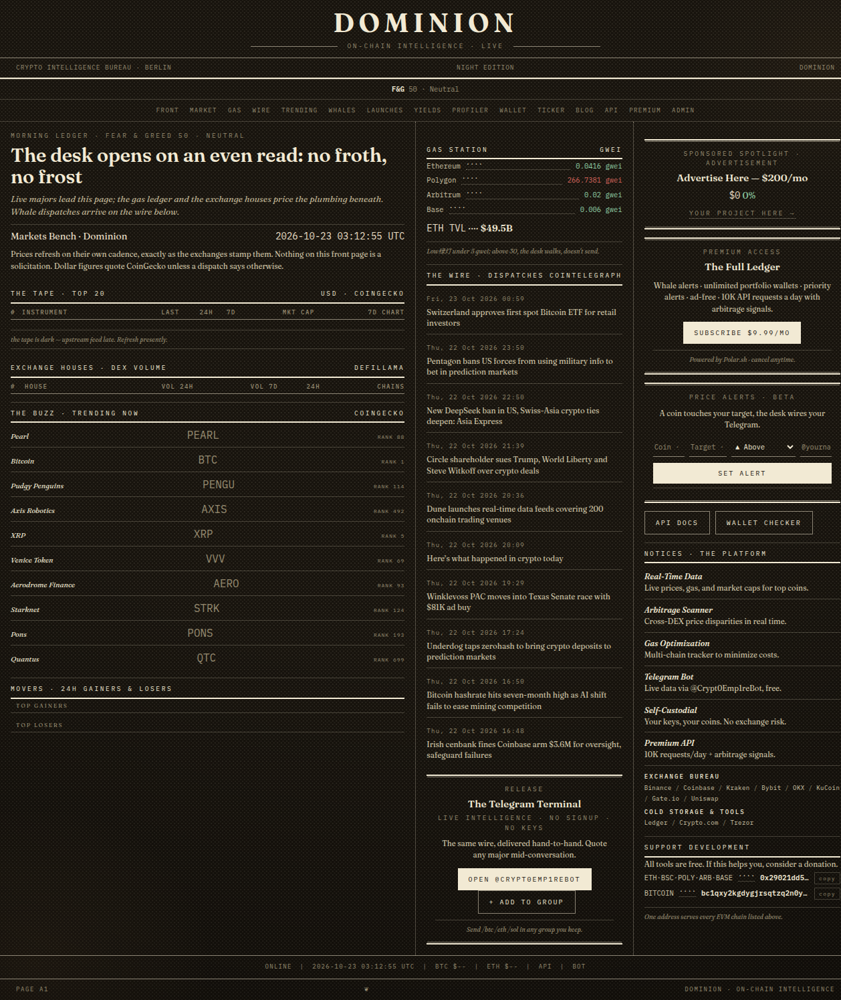
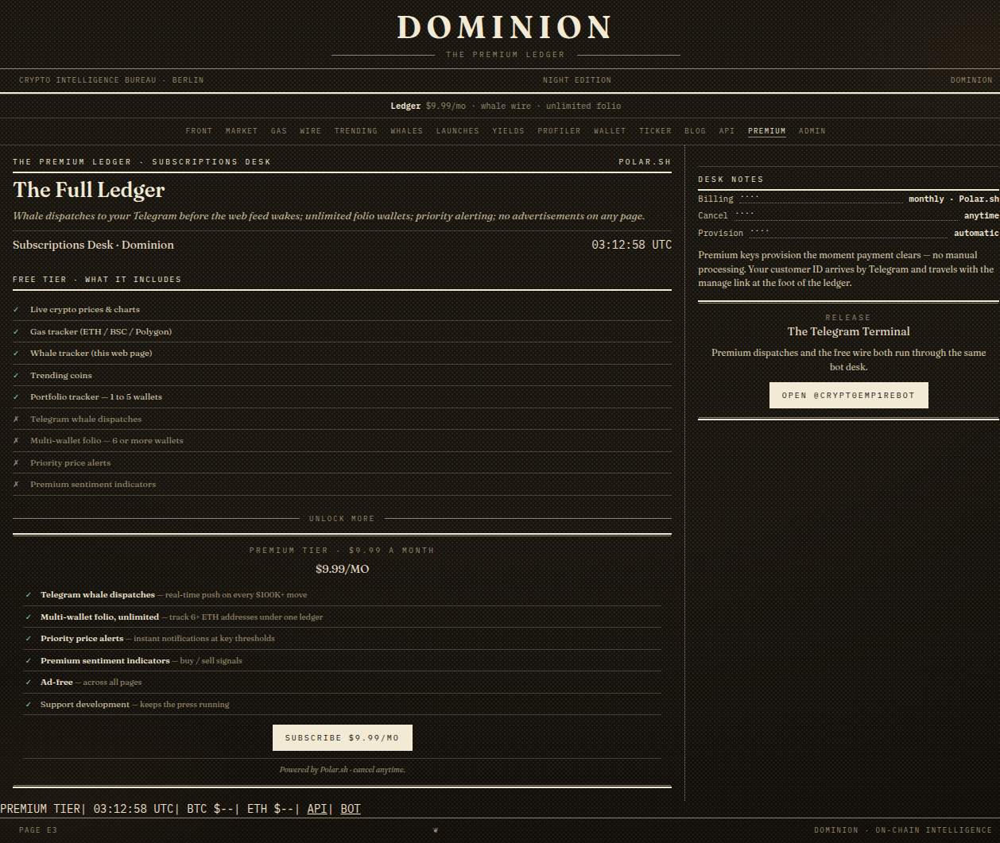
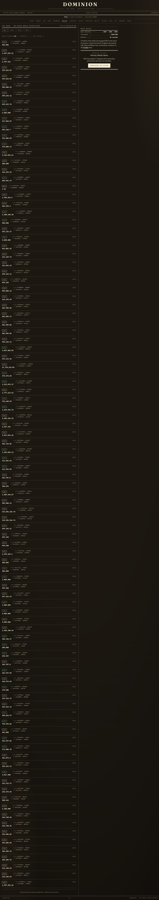
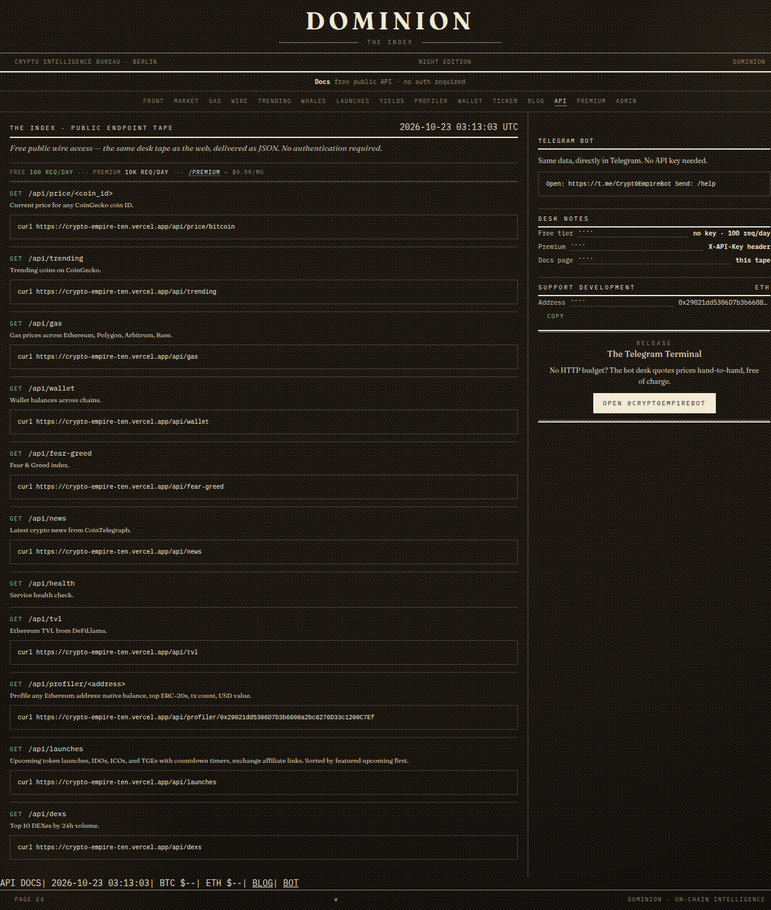
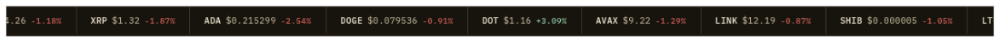
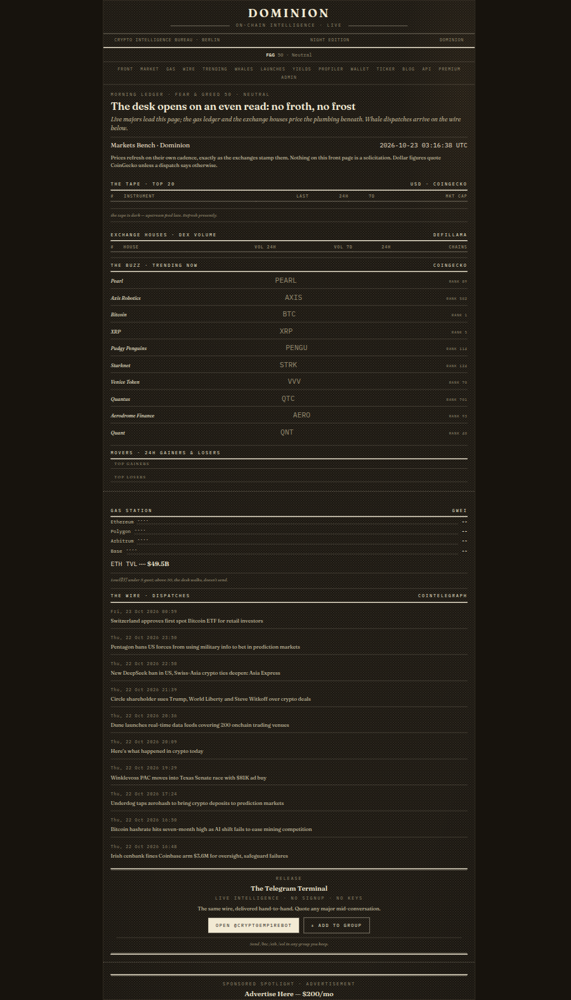

# ⛰️ Dominion — Autonomous Crypto Intelligence · Night Edition

> **Live market dashboard + Telegram bot with 50+ commands, whale tracking, and premium monetization — set as a night-print newspaper.**

[](https://crypto-empire-ten.vercel.app)
[](https://t.me/Crypt0Emp1reBot)
[](https://python.org)
[](https://flask.palletsprojects.com)
[](https://polar.sh)
[](#-the-night-edition-design)

---

## 🎯 What It Does

Dominion is a **two-in-one crypto intelligence system**:

1. **🌐 Web Dashboard** — Live prices, gas tracker, whale moves, DEX volumes, portfolio tracking, yield aggregation, token launch calendar — all at `crypto-empire-ten.vercel.app`
2. **🤖 Telegram Bot** — 50+ commands via `@Crypt0Emp1reBot` — price lookups, gas checks, wallet profiling, whale alerts, and more

---

## 📷 The Pages (Night Edition)

|  |
|:---:|
| **The Front Page** — masthead, tape, the wire, dispatches |

|  |  |
|:---:|:---:|
| **The Full Ledger** (`/premium`) | **Whale Dispatches** (`/whales`) |

|  |  |
|:---:|:---:|
| **Endpoint Tape** (`/docs`) | **Ticker Strip** (`/ticker`, embeddable) |

|  |
|:---:|
| **Mobile** — single-column folio flow |

---

## 🔥 Dashboard Features

### 📊 Live Market Intelligence
- **Top 20 Cryptos** — rank, price, 24h%, 7d%, sparkline SVG, market cap, volume
- **Multi-chain Gas Tracker** — real-time Ethereum, Polygon, Arbitrum, Base (polls every 30s)
- **Fear & Greed Index** — 7-day history with classification
- **Trending Coins** — top 10 on CoinGecko with live prices
- **Market Movers** — 24h gainers & losers with price/change

### 🔍 On-Chain Tools
- **Wallet Checker** — check any ETH address across Ethereum, Arbitrum, Base, Polygon
- **Wallet Profiler** — deep inspection: ETH balance, tx count, top 11 ERC-20 tokens, USD values
- **Portfolio Tracker** — create named portfolios (up to 5 addresses free, unlimited premium). Auto P&L tracking with shareable URLs.
- **Whale Tracker** — real-time USDT/USDC/WBTC transfers >$100K on Ethereum (refreshes every 5 min)

### 📈 DeFi & Markets
- **DEX Volume Rankings** — top 10 DEXes by 24h volume (DeFiLlama)
- **Yield Aggregator** — curated pools: lending, staking, stablecoin yields, filterable by APY/chain/TVL
- **Token Launch Calendar** — upcoming IDOs/ICOs/TGEs with countdown timers
- **Live Crypto News** — latest from CoinTelegraph RSS

### 💰 Monetization
- **Premium subscription** — $9.99/month via Polar.sh
- **Ad placement system** — banner slots with CRUD admin API
- **Sponsored coin spotlight** — paid placements with live price
- **Affiliate links** — Binance, Coinbase, Kraken, Bybit, OKX, KuCoin, Gate.io, Uniswap, Ledger, Trezor, Crypto.com
- **Donation system** — BTC + ETH addresses

---

## 🤖 Telegram Bot (@Crypt0Emp1reBot)

| Command | Description |
|---------|-------------|
| `/price <coin>` / `/btc` `/eth` `/sol` | Instant price lookup for 80+ symbols |
| `/gas` | Live multi-chain gas prices |
| `/fear` | Fear & Greed Index |
| `/trending` | Top 10 trending coins |
| `/news` | Latest 5 crypto headlines |
| `/wallet <0x>` | Multi-chain balance check |
| `/whales` | Recent $100K+ on-chain moves |
| `/profiler <0x>` | Deep wallet analysis |
| `/portfolio` | Multi-wallet portfolio tracker |
| `/yields` | Yield aggregator |
| `/launches` | Upcoming TGE/IDO calendar |
| `/convert 1 BTC USD` | Crypto converter |
| `/premium` | Subscribe to premium |

**Premium-only:** Real-time whale alerts · Unlimited portfolio wallets · Priority price alerts · Buy/sell sentiment signals · Ad-free

---

## 🏗️ Architecture

```
┌─────────────────────────────────────────────────┐
│               Vercel (Primary)                   │
│  ┌──────────────────────────────────────────┐    │
│  │          Flask App (app.py)              │    │
│  │  Dashboard  TG Webhook  Polar Webhook    │    │
│  │  REST API   Admin CRUD  Whale Cache      │    │
│  └──────────────────────────────────────────┘    │
└──────────────────────┬──────────────────────────┘
                       │
┌──────────────────────┴──────────────────────────┐
│          Home Server (Systemd)                  │
│  ┌──────────────────────────────────────────┐   │
│  │   bot.py — Telegram polling mode          │   │
│  │   dominion-bot.service — always-on daemon │   │
│  └──────────────────────────────────────────┘   │
└──────────────────────┬──────────────────────────┘
                       │
┌──────────────────────┴──────────────────────────┐
│          GitHub Actions (Cron)                   │
│  ┌────────┐ ┌────────────┐ ┌────────────────┐   │
│  │Monitor │ │Whale Tracker│ │Check Alerts    │   │
│  │30min   │ │5min         │ │15min           │   │
│  └────────┘ └────────────┘ └────────────────┘   │
└─────────────────────────────────────────────────┘
```

---

## 🛠️ Tech Stack

| Layer | Choice |
|-------|--------|
| **Backend** | Python 3.11, Flask 3.0, Gunicorn |
| **Frontend** | Server-side Jinja2 + vanilla JS, no framework |
| **Data APIs** | CoinGecko, DeFiLlama, Alternative.me, CoinTelegraph |
| **On-chain** | Public Ethereum RPCs (`eth_gasPrice`, `eth_call`, `eth_getBalance`) |
| **Telegram** | python-telegram-bot (polling + webhook dual mode) |
| **Payments** | Polar.sh ($9.99/mo) — full webhook verification |
| **Database** | SQLite (price cache, alerts, subscriptions) |
| **Deploy** | Vercel (web) + Systemd daemon (TG bot) |
| **CI** | 5 GitHub Actions workflows (monitor, whale-tracker, check-alerts, distribution, secret-scan) |
| **Design** | **Night Edition** — night-print paper `#17130d`, Fraunces (headlines) + IBM Plex Mono (data), oxblood `#d4635a` / print-green `#8fcea5` accents, halftone & stain overlays, folios + dotted-leader ledger rows; zero cards, zero radii, zero gradients |

---

## 🖤 The Night Edition Design

The interface is art-directed as a **late-night broadsheet set on a printing press**, not a SaaS dashboard:

- **Mastheads, not navigation bars** — every page opens with a tracked-caps `DOMINION` masthead, kicker rule pairs, and a folio line (`DOMINION · DAY 2xx · page E3`) exactly where a newspaper puts its edition marks.
- **Ledger rows, not cards** — data is set with dotted-leader rows (`label ···· value`), column rules, and cross rules; no cards, border-radius, box-shadows, or gradients anywhere.
- **Two typefaces only** — `Fraunces` (UPM-2000 optical display serif) for headlines and deks, `IBM Plex Mono` for every number, table, ticker, and label.
- **A restrained ink palette** — night paper `#17130d`, warm ink `#e9dfc6`, with exactly two accent inks: oxblood for losses/CTAs and print-green for gains/live states.
- **Press furniture** — halftone-dot overlay, vignette, paper stains, ivory-tape labels, and a fixed rule system (`--rule` / `--rule-strong`) borrowed from paste-up printing.
- **The Telegram bot is set the same way** — wires open masthead-first (`DOMINION — PRICE`), close with a `❦` folio footer, and use ❧ bullets, ▲/▼ tones, and dotted leaders in plain text.
- **No JS UI framework** — the whole design system lives in one Python file (`design.py`) and consumes dynamic data; every page ships server-side rendered.

---

## 📊 API (30+ Endpoints)

All dashboard data is exposed as public REST API:

```
/price/<coin>   /trending   /gas   /fear-greed   /news
/tvl            /dexs       /movers            /whales
/wallet/<addr>  /profiler/<addr>              /portfolio
/yields         /launches   /alerts            /health
/premium/checkout /premium/webhook            /premium/check
```

Free tier: 100 req/day · Premium: 10K req/day

---

## 📊 Status

- **Version:** v3.4
- **Deploy:** Live at crypto-empire-ten.vercel.app
- **Bot:** `@Crypt0Emp1reBot` — always on
- **Revenue:** $0 (no subscribers yet)
- **Monitoring:** 5 GH Actions workflows keep everything running

---

## 🧠 Skills Demonstrated

`Python` `Flask` `REST API Design` `Telegram Bot (50+ commands)` `CoinGecko API` `DeFiLlama` `On-chain RPC` `Whale Tracking` `Polar.sh Integration` `SQLite` `Vercel Deployment` `Systemd Daemon` `GitHub Actions` `Print-Editorial Design (Night Edition)`

> *Build your own Bloomberg Terminal for crypto — then sell access.*
